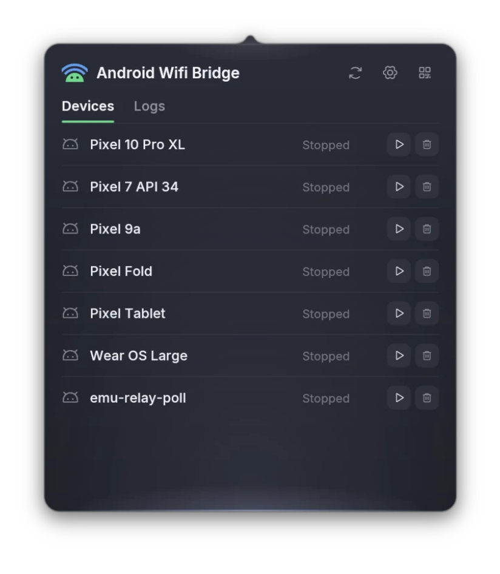

# awb

Android Wifi Bridge for macOS: pair, connect, and mirror Android phones over Wi-Fi,
or launch configured Android Virtual Devices, without remembering SDK commands.

<p align="center">
  
</p>

awb wraps Android's wireless debugging flow behind a QR code. Scan it with your phone and
awb handles mDNS discovery, `adb pair`, `adb connect`, and reconnects, then launches
[scrcpy](https://github.com/Genymobile/scrcpy) screen mirroring if you want it. It ships as
two small native binaries: the `awb` CLI and a menu bar app.

## Install

```sh
curl -fsSL https://github.com/ovitrif/awb/releases/latest/download/install.sh | sh
```

Pin a release or choose the install directory:

```sh
curl -fsSL https://github.com/ovitrif/awb/releases/latest/download/install.sh | \
  AWB_INSTALL_TAG=v2.1.0 AWB_INSTALL_DIR="$HOME/.local/bin" sh
```

Requirements: `adb` on your PATH (Android SDK platform-tools). `scrcpy` is optional and
only needed for screen mirroring. Launching AVDs requires the Android SDK Emulator;
deleting them requires Android SDK Command-Line Tools (`avdmanager`). The phone needs
Android 11+ with developer options enabled, on the same Wi-Fi network as your Mac.

## Menu bar app

```sh
awb app
```

The awb icon appears in the menu bar. Left-click toggles the popover: a Devices tab
listing connected phones (with one-click mirroring) and configured emulators, a Logs tab,
Settings, and QR pairing for new phones. Refresh, Settings, and Pair stay in the top-right
corner on every page. Each configured AVD stays listed while stopped, starting, or running.
Click the play icon to open its native Android Emulator window, or the trash icon to delete
a stopped AVD and its saved data after confirmation. Both actions are disabled while the
emulator is starting or running. Right-click (or control-click) offers Show, Pair, Refresh,
and Quit.

The popover works from the keyboard: Tab moves between controls, Return or Space activates
the focused one, Escape closes the popover, and ← / → step back and forward through the
pages you visited, then through Main, Settings, and Pair in order.

macOS release archives also contain `Android Wifi Bridge.app` for /Applications and login items; it is the
same menu bar app in a bundle.

## CLI

```sh
awb
```

Running `awb` with no arguments checks ADB, shows a QR code, and guides the phone from
`Developer options -> Wireless debugging -> Pair device with QR code` to a connected
device, with live waits, retries, and manual IP:port fallbacks when discovery misbehaves.
Once connected it offers to start scrcpy.

Useful commands and flags:

```sh
awb status --json        # ADB, scrcpy, and device status for scripts and UIs
awb reset-adb            # kill and restart the local ADB server
awb completions zsh      # print zsh completions
awb app                  # launch the menu bar app
awb --connect-only       # pair and connect without the scrcpy menu
awb --background         # start scrcpy detached and exit
awb --foreground         # start scrcpy and wait until it exits
awb --stable             # scrcpy + keepalive watch + reconnects + Wi-Fi diagnostics
awb --watch --wifi-doctor
awb --timeout 120        # wait longer than the 60-second default
awb --device-serial SERIAL --background
awb --window-title "Pixel 10 Pro" --window-width 480 --window-height 1071
awb --plain-window --always-on-top
awb --adb /path/to/adb --scrcpy /path/to/scrcpy
```

By default scrcpy launches borderless at 480x1071 with `--stay-awake` and no audio; pass
`--plain-window` for scrcpy's regular decorated window. The menu bar app stores its scrcpy
options in `~/.config/awb/config.toml`.

On Apple silicon, awb prefers the scrcpy bundled in `Android Wifi Bridge.app` (from the
release archive, in `/Applications`), which runs as its own app,
`Contents/Helpers/Android Mirror.app` (`com.ovitrif.awb.mirror`). It is a pinned scrcpy release
patched to draw a QuickTime-style mirror window: rounded corners, a title bar with traffic
lights over the top of the screen while the pointer is over it, and ⌘ + drag anywhere to move
the window. It needs Homebrew's scrcpy dependencies; without them, or without the app, awb
uses `scrcpy` from your PATH.

## Build from source

```sh
git clone https://github.com/ovitrif/awb.git
cd awb
cargo build --release            # target/release/awb and target/release/awb-app
scripts/build-scrcpy.sh          # optional: patched scrcpy into target/scrcpy (needs meson, ninja, Homebrew ffmpeg, sdl3, libusb)
scripts/bundle-app.sh            # optional: wraps awb-app (and target/scrcpy) into target/bundle/Android Wifi Bridge.app
```

The workspace has three crates: `awb-core` (ADB, scrcpy, QR, and Bonjour logic), `awb`
(the CLI), and `awb-app` (the menu bar app, built from the design in `DESIGN.pen`).
`scrcpy/macos-window.patch` holds the mirror window patch; `scripts/build-scrcpy.sh` pins the
scrcpy version and says how to move the patch to a new release.

## License

MIT. Bundled [Inter](https://rsms.me/inter/) font is licensed under the SIL OFL 1.1;
icons are [Phosphor](https://phosphoricons.com/) (MIT).
